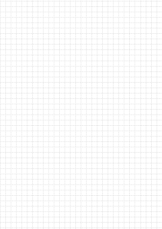

# 方格筆記模板

A4 滿版方格紙 PDF，給 Drawboard PDF 等手寫筆記軟體使用。

| 檔案 | 方向 |
|---|---|
| [方格筆記_直向_1頁.pdf](方格筆記_直向_1頁.pdf) | 直向 A4 |
| [方格筆記_橫向_1頁.pdf](方格筆記_橫向_1頁.pdf) | 橫向 A4 |

- 每格 7 mm，淺灰細虛線，整頁滿版、沒有外框
- 格線放在名為「網格」的 PDF 圖層：在 Adobe Acrobat 左側「圖層」面板關掉眼睛圖示，就能只顯示／列印手寫內容

| 直向 | 橫向 |
|---|---|
|  |  |
